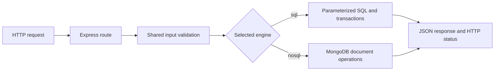

# Node.js API walkthrough

The API is running at `http://localhost:3000`. It connects to the two real databases already prepared for the assignment. You can open `/health` in a browser to see whether each database is reachable.

## Step 1: Understand the request path



For example, `POST /api/sql/projects` creates a project in PostgreSQL. Changing `sql` to `nosql` sends the same kind of request to MongoDB. The engines have independent data, and each request selects one of them.

Start with `src/app.js`: it decides which store to call. `src/validation.js` checks the incoming fields. The two files in `src/stores/` contain the actual database operations.

## Step 2: Start or check the application

In PowerShell, open the repository folder and run:

```powershell
docker compose up -d --build --wait --wait-timeout 180
docker compose ps
Invoke-RestMethod 'http://localhost:3000/health'
```

There should be three healthy services: `api`, `postgres`, and `mongo`. Compose runs Node.js inside a container, so host npm installation is unnecessary.

## Step 3: Create a project with a task

Run these commands in the same PowerShell session so the variables remain available:

```powershell
$base = 'http://localhost:3000'
$engine = 'sql'
$root = "$base/api/$engine/projects"
$body = @{
    title = 'Build a portfolio website'
    description = 'AD371 walkthrough'
    tasks = @(@{ title = 'Design the homepage'; status = 'todo' })
} | ConvertTo-Json -Depth 4

$created = (Invoke-RestMethod -Method Post -Uri $root -ContentType 'application/json' -Body $body).data
$projectUrl = "$root/$($created.id)"
$created | ConvertTo-Json -Depth 6
```

The API returns **201 Created** and a Location header containing the new URL. `Invoke-RestMethod` displays the JSON data; the included demo script prints statuses explicitly. You do not choose IDs: the server generates UUIDs.

Read `createProject` in `src/stores/sql.js`. It inserts the parent, inserts its tasks, and commits on the same connection. If a child insert fails, it rolls back every write in that transaction. The `finally` block releases the connection.

For MongoDB, `createProject` in `src/stores/mongo.js` constructs one document with a tasks array and inserts it once. That is a single-document atomic operation.

## Step 4: Read the data and inspect the databases

```powershell
Invoke-RestMethod -Uri $projectUrl | ConvertTo-Json -Depth 6
Invoke-RestMethod -Uri $root | ConvertTo-Json -Depth 6
```

`GET` returns **200 OK**. A complete-project SQL read uses a LEFT JOIN. A complete-project MongoDB read uses one `findOne`. Project list results are paginated summaries with `task_count`, rather than returning every embedded task for every project.

Inspect the SQL data directly:

```powershell
docker compose exec postgres psql -X -U campus -d campus_tracker
```

Inside `psql`, run:

```sql
SELECT p.title AS project, t.title AS task, t.status
FROM projects p LEFT JOIN tasks t ON t.project_id = p.id;
```

Type `\q` to return to PowerShell. After repeating the create step with `$engine = 'nosql'`, inspect its document:

```powershell
docker compose exec mongo mongosh campus_tracker
```

Inside `mongosh`, run:

```javascript
db.projects.findOne({ title: 'Build a portfolio website' })
```

Type `exit` to return to PowerShell. These database viewers are important for the video: they prove what was actually persisted.

## Step 5: Update one task

```powershell
$taskId = $created.tasks[0].id
$taskUrl = "$projectUrl/tasks/$taskId"
$change = @{ status = 'done' } | ConvertTo-Json
Invoke-RestMethod -Method Patch -Uri $taskUrl -ContentType 'application/json' -Body $change
Invoke-RestMethod -Uri $taskUrl
```

`PATCH` changes only supplied fields. In SQL, the task update uses placeholders such as `$1`, with values supplied separately to the driver. In MongoDB, `$set` targets the matching embedded task. The application does not read an entire tasks array and replace it with a stale copy.

Concurrency matters when adding tasks too. SQL locks the project before counting and inserting. MongoDB puts the capacity condition and `$push` into one atomic update. The live test sent eight simultaneous requests to a 99-task project: one succeeded and seven returned **409 Conflict**, in each engine.

## Step 6: Delete and observe the missing-record response

```powershell
Invoke-RestMethod -Method Delete -Uri $projectUrl
try {
    Invoke-RestMethod -Uri $projectUrl
} catch {
    [int]$_.Exception.Response.StatusCode
}
```

The delete returns **200 OK**. The subsequent read returns **404 Not Found**. PostgreSQL cascades deletion to task rows; MongoDB removes the document, including its embedded tasks.

To compare the other engine, set `$engine = 'nosql'` and repeat the creation, read, update, and deletion blocks. Recompute `$root`, `$created`, `$projectUrl`, and `$taskUrl`; the IDs from SQL do not identify records in MongoDB.

## Step 7: Run the repeatable demonstration and QA

```powershell
docker compose exec -T api npm run demo
docker compose exec -T api npm test
```

The demo performs project/task CRUD through both sets of endpoints, prints HTTP statuses and JSON, intentionally triggers a 400, and shows a 404 after deletion. It cleans up its own records. The integration suite runs 26 scenarios using real HTTP requests and database checks.

The SQL rollback scenario calls the real store directly with a deliberately invalid second child. This forces a database failure after the parent and first child have been inserted; HTTP validation normally prevents that invalid input from reaching the store. The test verifies rollback and connection reuse after 12 such failures.

For the required direct database constraint demonstration, also run the original checks:

```powershell
docker compose exec -T postgres psql -X -U campus -d campus_tracker -v ON_ERROR_STOP=1 -f /checks/sql-checks.sql
docker compose exec -T mongo mongosh --quiet --file /checks/mongo-checks.js
```

The SQL script proves orphan rejection and cascade behavior. The MongoDB script proves the duplicate-task-ID audit correction. These checks are separate from API input validation.

## Step 8: Explain the architecture in your own words

- The HTTP interface is consistent across both engines.
- PostgreSQL stores related entities in separate tables, enforces the foreign key, and uses transactions for related writes. It fits workloads with relationships and cross-project reporting.
- MongoDB embeds the bounded task list because the main read needs one complete small project. Atomic document updates fit that access pattern. An unlimited task history or extensive cross-project reporting could call for a different model.
- Parameterized SQL and strict input validation address different problems: parameters preserve the distinction between query syntax and data; validation enforces the application's allowed input.
- The genuine AI audit issue was missing task-ID uniqueness inside a MongoDB document. The saved draft, correction, and live rejection test provide evidence. Credit the AI-assisted correction accurately.

The README lists every endpoint. `docs/qa-results/` contains actual outputs. This walkthrough is a practice guide; the student still needs to record the required screen-and-webcam video.
